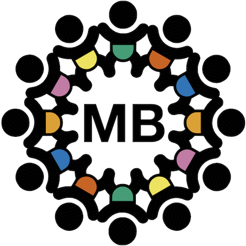

<section>
  <header class="major">
		<h2>General Contact Info</h2>
	</header>
  

    

      

         
        
      

      

         
        <b>Contact info:</b> <a href="mailto:{{ site.data.global.contact.general }}">General</a>, <a href="mailto:{{ site.data.global.contact.govboard }}">Governing Board</a>, 
          <a href="mailto:{{ site.data.global.contact.director }}">Executive Director</a> <i> 
          (more info available <a href="{{site.baseurl}}/people/">here</a>)</i> 
        <b>General MB Listserv:</b> <a href="{{ site.data.global.listserv.general }}"><i>Subscribe</i></a>  
        <b>General MB Slack:</b> <a href="{{ site.data.global.link.slack-invite }}"><i>Join workspace</i></a>
      

    

  

   
</section>
 

***

In addition to collecting data, there are many contribution opportunities (e.g., study design, data analysis, writing) which do not require access to an infant lab.  
**All are welcome!**

### Ways to get involved: 


- #### Subscribe to Listservs *(Most of our communications are done via email!)*
  - **Subscribe to our [general MB listserv](https://mailman.stanford.edu/mailman/listinfo/manybabies)** *(community announcements, monthly newsletter, etc.)*
  - **Subscribe to project-specific listservs**
    

      <i>To join a group directly, click on the links in the list below. (Note: Most of our project listservs are Google Groups, and to join directly you must be logged-in to the browser with a Google-linked account.)</i> 
      

        
   <!-- Expandable listserv list -->
          
<code>Subscribe directly to project listservs</code>
 
            <ul>
              
                <li><a href="{{ project.listservSub }}"><b>{{ project.project }}:</b></a> <i>{{ project.description }}</i></li> 
               <!-- projects loop -->
            </ul>
        

      

      <i>If you do not have a Google-linked account or need help joining groups, fill out the listserv form below.</i>
      

        
   <!-- Expandable form -->
          
<code>Fill out our listserv form</code>
 <!--- expandable listserv form -->
            <iframe class="airtable-embed" src="https://airtable.com/embed/appRoqMKzcK3NsXt4/pagSEk7WDc7aVkmXt/form" frameborder="0" onmousewheel="" width="100%" height="533" style="background: transparent; border: 1px solid #ccc;"></iframe>
        

      

    

- #### Email project leads
  - If you know which project you are interested in joining, you can **email** one or more of the Project Leads directly to ask how to get involved. Contact info for Project Leads is available via each [**project page**]({{site.baseurl}}/projects/).
- #### Come to Director Office Hours
  - You are welcome to join our **MB Director Office Hours** to talk about ManyBabies and ways to get involved. Times and links to join via Zoom can be found in our [**calendar**]({{site.baseurl}}/calendar/).
- #### Propose a Project
  * **Do you have an idea for a ManyBabies project?** Let us know! You can email Project Leads (for spin-off projects) or the [**Governing Board**](mailto:{{ site.data.global.contact.govboard }}) (for new projects), or **fill out our <a href="https://docs.google.com/document/d/1_bixhwCMPkMBDxh5epS1czue8emAakFmy0IG29oxQfQ/template/preview">Project Proposal Template</a>**.

<!--
 

***

<h2 id="signupform">ManyBabies Sign-Up Form</h2>
To express interest in contributing to one or more **ManyBabies** project(s), please fill out this form. We'll be in touch as soon as possible with more info. 

<iframe class="airtable-embed" src="https://airtable.com/embed/appRoqMKzcK3NsXt4/pagp5tSLS8TAkBvKV/form" frameborder="0" onmousewheel="" width="100%" height="533" style="background: transparent; border: 1px solid #ccc;"></iframe>
-->

